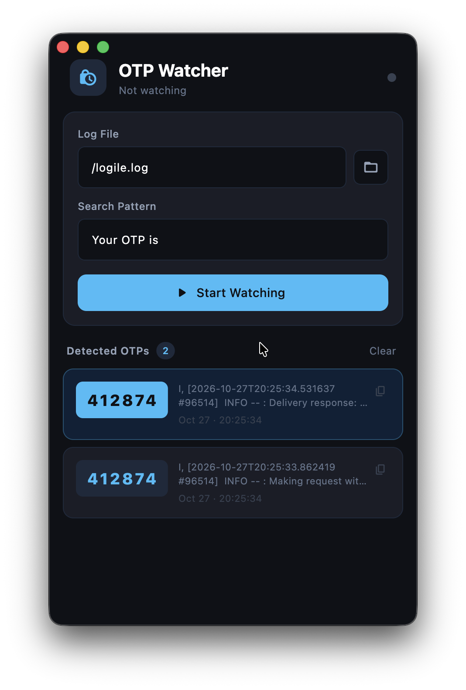

# OTP Watcher

A small desktop app that watches an SMS log file and surfaces one-time passwords as they arrive. When a new matching line is written, OTP Watcher extracts the code, copies it to the clipboard, plays an alert, and shows a desktop notification.

It is aimed at local SMS gateway logs (for example an Africa's Talking SMS log) where verification codes land in a `.log` or `.txt` file instead of on a phone.

This saves you from having to open the file and search for the code manually or wait for the SMS to arrive on your phone.

## How it works



1. Choose a log file, or paste its path.
2. Set a search pattern that appears in OTP lines. The default is `Your OTP is`.
3. Start watching. The app polls the file every 2 seconds and reads only bytes appended since the last check.
4. A line matches when it contains the pattern (case-insensitive) and a 4–8 digit code appears after it.
5. Each match is added to the list, copied to the clipboard, announced with a notification, and played as an alert sound.

Lines already in the file when watching starts are ignored. If the file is truncated or rotated, the watcher resets and continues from the new end.

Example line:

```text
Your OTP is 482193. It expires in 5 minutes.
```

Detected code: `482193`.

## Features

- Live tail of a `.log` or `.txt` file
- Configurable search phrase
- Automatic clipboard copy
- Desktop notification and alert sound
- History of detected codes with timestamps
- Saved file path and search pattern between launches

## Requirements

- macOS (the app is a desktop window with local notifications)
- [Flutter](https://docs.flutter.dev/get-started/install) 3.35.5

This repo pins that SDK with [FVM](https://fvm.app/). If you use FVM, prefix the commands below with `fvm`.

## Run

```bash
flutter pub get
flutter run -d macos
```

Grant notification permission the first time a code is detected, or the alert will be silent.

## Project layout

```text
lib/
  main.dart                 App entry and window setup
  home_screen.dart          File picker, pattern, and OTP list
  watcher_service.dart      File polling and OTP extraction
  notification_service.dart Desktop notification and alert sound
  otp_entry.dart            Detected code model
assets/
  audio/                    Alert sound
```
